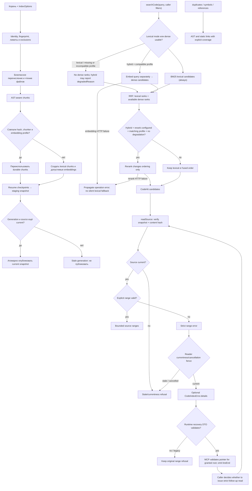
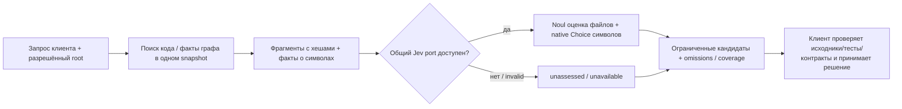

# Code: индекс и структурный анализ

`createCodeIndex` связывает code chunks со snapshot repository/worktree. Индексация использует bounded enumeration, AST-aware chunking, checkpoints и staging; current snapshot меняется только при совпадении поколения.

Публикация группирует записи в ограниченные SQL batches: до 64 code chunks и до 128 symbols или references за запрос. Между batches процесс уступает event loop и повторно проверяет отмену. Записи остаются внутри существующей транзакции публикации: отмена или ошибка откатывает незавершённый snapshot. Эти пределы описывают размер записи, а не обещают время индексации.

| Условие | Результат | Кодовая опора |
| --- | --- | --- |
| Нет current snapshot | `indexStatus` возвращает пустую identity; search/read отказывают как stale, а не выдают пустой успешный ответ. | `current`, `indexStatus`, `searchCode` |
| Lexical mode или отсутствующий/несовместимый профиль | BM25 доступен; dense обходится, hybrid сообщает `degradedReason`; Code rerank требует hybrid, matching profile и отсутствия degradation. | `searchCode`, `denseReason`, `statusFrom`, `ranking.ts` |
| HTTP embedding/rerank failure | Операция завершается ошибкой, без auto lexical fallback. | providers ports |
| Generation/source изменились | Не публиковать или не выдавать старые данные как current. | `indexRepository`, `readSource` |
| Symbol/reference найден | Статический AST/path resolution, не доказательство runtime-вызова. | `symbol-*`, `dependency-graph.ts` |
| Duplicate совпал | Возвращаются bounded groups и coverage/truncation counts. | `findDuplicateBodies` |

Профиль `voyageai/voyage-code-4` 1024d — необязательный конфигурационный preset; его выбор требует явного runtime config. Текущий legacy code profile не задаёт Voyage `input_type`; query-role change остаётся экспериментом. Необязательный `voyageai/rerank-2.5-lite` получает fusion-кандидатов и только меняет их порядок; место в списке не подтверждает истинность или корректность кандидата. AST chunks, symbols, references и duplicate groups — структурные/текстовые evidence, не вывод Jev.

В source candidate `0a584e6` необязательный `createReuseContext` связывает существующий индекс кода с Jev. Схема показывает границы этой опции:

Reuse не индексирует проект заново, не меняет embedding/rerank профиль и не редактирует код. По умолчанию он выбирает не более 24 файлов-кандидатов, ограничивает текст контекста 48 000 символами и операцию 60 секундами; неполное покрытие и omissions входят в ответ. Общий источник сведений об API и миграции — [руководство Jev](../../docs/jev-classification.md). Эта функция доступна только в исходниках: archive `v0.1.6` её не содержит.

Symbol metadata учитывает настроенное `maxFiles` code index при построении, чтении и проверке актуальности. Значение по умолчанию остаётся 5 000, а заданный предел до 20 000 не подменяется скрытой границей 5 000 при обработке symbols. Неподдерживаемые типы файлов и неразрешённые статические связи остаются в partial coverage; `complete` не означает полноту runtime-графа.

Embeddings и reranking — самостоятельные необязательные retrieval-порты. Jev оценивает смысл запроса и кандидатов только в путях reuse/classification; он не выбирает retrieval profile и не доказывает истинность или безопасность найденного кода.

`readSource` строго отклоняет любой явный недопустимый диапазон: начало вне файла, конец за EOF или span больше 1000 строк. Для стабильной ошибки фактического файла reader после currentness/cancellation fence может приложить к `CodeIndexError.details` только число строк, безопасный `lineStart`, `snapshotId` и default cap 200 строк. Runtime валидирует DTO; MCP проверяет указатель по строгой read-схеме и уже проверенному grant для root. `lineEnd` опускается. Клиент сам решает, выполнять ли новый строгий read; этот read снова проверяет snapshot. Отказ не смягчается, а источник не ограничивается молча, не индексируется и не отправляется внешнему provider.

Действующие операции включают `indexRepository`, `searchCode`, `readSource`, `findCodeDuplicates`, `indexCodeSymbols`, `findCodeSymbols`, `findCodeReferences`, `traceCodeCalls`, `relatedCode`. Исходники: [`index.ts`](https://github.com/zoomplus/zorya-search/blob/main/src/code/index.ts), [`ranking.ts`](https://github.com/zoomplus/zorya-search/blob/main/src/code/ranking.ts), [`duplicates.ts`](https://github.com/zoomplus/zorya-search/blob/main/src/code/duplicates.ts), [`schema.ts`](https://github.com/zoomplus/zorya-search/blob/main/src/code/schema.ts).
