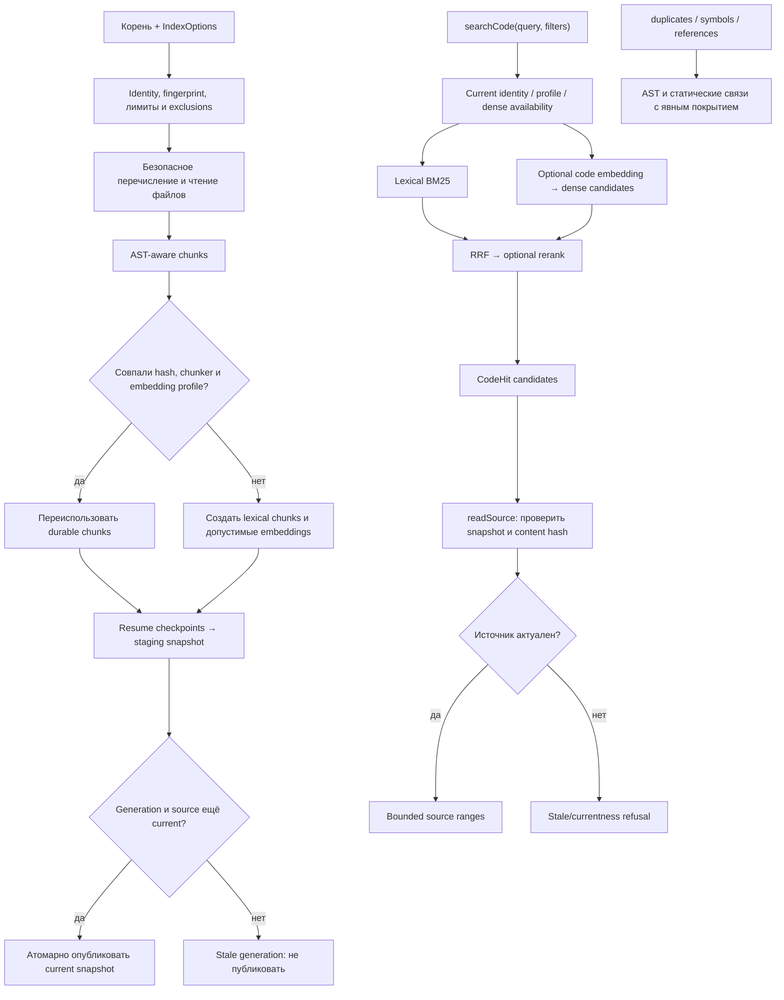

# Code: индекс и структурный анализ

`createCodeIndex` связывает code chunks со snapshot repository/worktree. Индексация использует bounded enumeration, AST-aware chunking, checkpoints и staging; current snapshot меняется только при совпадении поколения.

| Условие | Результат | Кодовая опора |
| --- | --- | --- |
| Нет current snapshot | `indexStatus` возвращает пустую identity; search/read отказывают как stale, а не выдают пустой успешный ответ. | `current`, `indexStatus`, `searchCode` |
| Явный lexical или отсутствующий/несовместимый профиль | Dense обходится; hybrid сообщает `degradedReason`. | `searchCode`, `denseReason`, `statusFrom` |
| HTTP embedding/rerank failure | Операция завершается ошибкой, без auto lexical fallback. | providers ports |
| Generation/source изменились | Не публиковать или не выдавать старые данные как current. | `indexRepository`, `readSource` |
| Symbol/reference найден | Статический AST/path resolution, не доказательство runtime-вызова. | `symbol-*`, `dependency-graph.ts` |
| Duplicate совпал | Возвращаются bounded groups и coverage/truncation counts. | `findDuplicateBodies` |

Профиль `voyageai/voyage-code-4` 1024d — необязательный конфигурационный preset; его выбор требует явного runtime config. Текущий legacy code profile не задаёт Voyage `input_type`; query-role change остаётся экспериментом. Необязательный `voyageai/rerank-2.5-lite` получает fusion-кандидатов и только меняет их порядок; место в списке не подтверждает истинность или корректность кандидата. Retrieval объединяет BM25 и optional dense ранги через RRF, затем может rerank. Предложенный reuse-context, который собирает существующие реализации, extension candidates, structural duplicate evidence и contracts/tests перед добавлением похожего кода, — **planned**. Нынешние search/duplicate/symbol API существуют, но такого автоматически собранного контекста не создают.

Действующие операции включают `indexRepository`, `searchCode`, `readSource`, `findCodeDuplicates`, `indexCodeSymbols`, `findCodeSymbols`, `findCodeReferences`, `traceCodeCalls`, `relatedCode`. Исходники: [`index.ts`](https://github.com/zoomplus/zorya-search/blob/main/src/code/index.ts), [`ranking.ts`](https://github.com/zoomplus/zorya-search/blob/main/src/code/ranking.ts), [`duplicates.ts`](https://github.com/zoomplus/zorya-search/blob/main/src/code/duplicates.ts), [`schema.ts`](https://github.com/zoomplus/zorya-search/blob/main/src/code/schema.ts).
