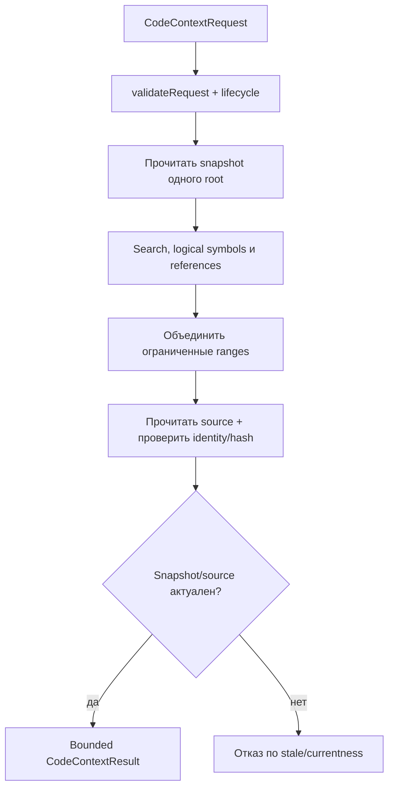
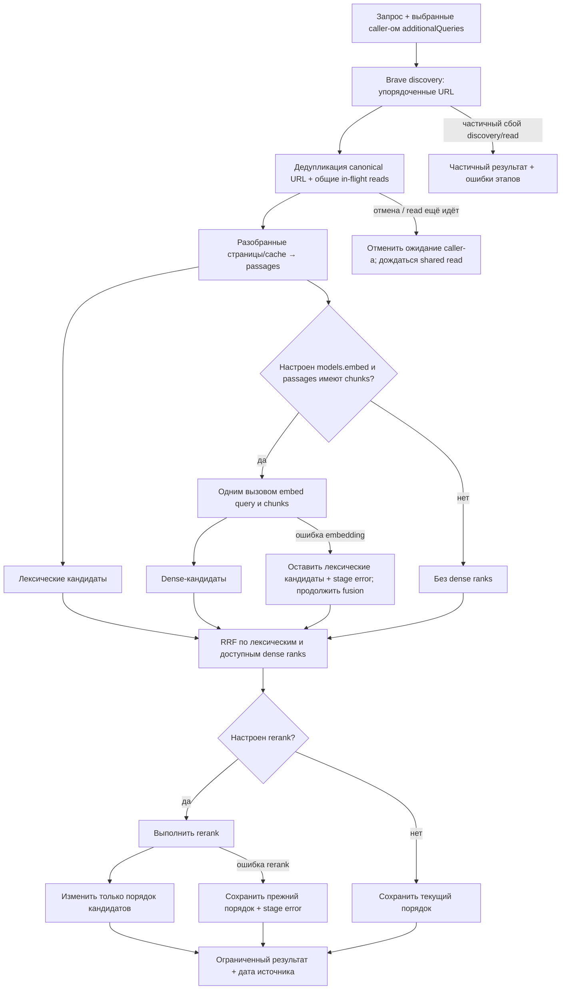
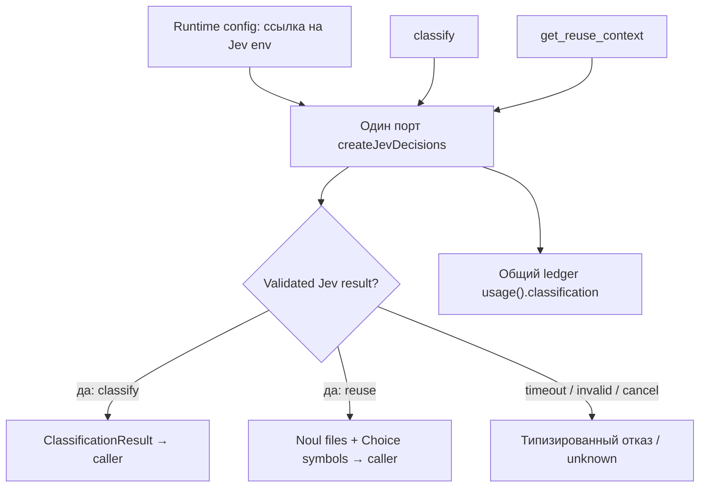
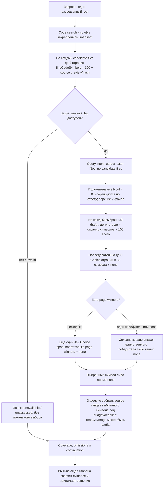

# Context: bounded code и web context

Context валидирует явный запрос и объединяет доступные материалы в ограниченный ответ. Источники, excerpts и classification — недоверенные evidence; вызывающий агент проверяет их и принимает решение.

## Code context — source candidate

## Web context — source candidate

Caller задаёт запросы; web-поиск не придумывает дополнительные темы.

Профиль embedding проверяется при создании контекста. Если заданы `models.embed` и passages с chunks, один вызов получает query и chunks. При ошибке embedding lexical candidates сохраняются, stage error фиксируется и обработка продолжает fusion. При ошибке rerank сохраняются прежний порядок и stage error.

## Classification — shared Jev port

## Переиспользование кода — исходное включение `0a584e6`, постраничный выбор `a85eb8c506c8`

У каждого Choice page только исходные code excerpts из того же snapshot: не более шести строк и 240 символов на символ. На одну операцию допускается не более 18 symbol-stage Decisions-вызовов и не более 20 вместе с query intent и файловым Noul; это граница вызовов port `decide`, а не физических HTTP-запросов, транспортных retry, embedding/rerank вызовов или стоимости провайдера. Локального сравнения confidence для выбора символа нет: страницы и их победителей оценивает Jev, а итоговый Choice вызывается только при нескольких page winners. `none`, неполный ответ, ошибка или исчерпание бюджета остаются явными состояниями, не подтверждённым выбором.

Чтение тела выбранного символа и ближайшего проверенного именованного executable ancestor собирается отдельно через bounded code context; результат полноты source обозначается в `readCoverage` и может быть ограничен бюджетом. Бюджет source context — 48 000 символов по умолчанию и до 64 000 по настроенному hard limit; deadline — 60 секунд по умолчанию и до 120 000 миллисекунд по hard limit. Выбор symbol pages сам по себе не выдаёт полные тела и не расширяет эти лимиты. Путь reuse использует тот же Jev port runtime, что и classification; его вызовы учитываются в общем ledger `usage().classification`. Он не меняет embedding/rerank профили, prompt, модель или workflow клиента. Source candidate и оставшиеся границы приёмки описаны в [руководстве Jev](../../docs/jev-classification.md).

| Условие | Результат | Кодовая опора |
| --- | --- | --- |
| Code snapshot/source hash изменился | Старые ranges не возвращаются как current. | `createCodeContext`, `collectLogicalContext` |
| Jev в reuse недоступен или ответ некорректен | Без локальных семантических эвристик; выбор файлов остаётся `unassessed`/`unknown`. | `createReuseContext`, `reuse-selection.ts` |
| Каталог символов продолжается или анализатор пометил путь `truncated` | Отдельно проверяйте cursor, summary `symbolAnalysis.truncation`/`coverageCounts`, а если path-level детализация доступна — совпадающую запись в массиве `findCodeSymbols.analysis.coverage`; `truncated` с `nextCursor` означает следующую страницу. | `createReuseContext`, `reuse-symbol-selection.ts` |
| Choice символов неполный или недоступен | `symbolSelection.files[]`, `selection.unassessed`, `omissions` и `continuation` сохраняют счётчики, состояние и следующий ограниченный шаг; `none` не становится выбранным символом. | `reuse-symbol-selection.ts`, `reuse-types.ts` |
| Покрытие чтения символов или исходников неполное | Ограниченные кандидаты сопровождаются явным состоянием, omissions и continuation. | `createReuseContext`, `reuse-types.ts` |
| Web часть упала, но страницы есть | Partial result и errors по этапам. | `createWebSearch` |
| Web embedding/rerank provider error | Ошибка сохраняется в `errors`, `partial=true`; lexical passages могут остаться в ответе, поэтому сбой не скрыт. | `web.ts` |
| Caller отменил shared read | Его ожидание отменяется отдельно; физический fetch не считается завершённым раньше settlement. | `BraveInFlightDocuments` |
| Additional query отсутствует | Search не придумывает его сам. | `snapshotAdditionalQueries` |

Web — публичный HTTP acquisition, не browser automation. Logical symbol/reference связи статические и не являются runtime call truth. Исходники: [`index.ts`](https://github.com/zoomplus/zorya-search/blob/main/src/context/index.ts), [`logical.ts`](https://github.com/zoomplus/zorya-search/blob/main/src/context/logical.ts), [`web.ts`](https://github.com/zoomplus/zorya-search/blob/main/src/context/web.ts), [`classify.ts`](https://github.com/zoomplus/zorya-search/blob/main/src/context/classify.ts), [`lifecycle.ts`](https://github.com/zoomplus/zorya-search/blob/main/src/context/lifecycle.ts).

Кодовая опора reuse: [`reuse.ts` — orchestration и лимиты](reuse.ts#L13), [`reuse-symbol-selection.ts` — страницы и Jev Choice](reuse-symbol-selection.ts#L10), [`reuse-types.ts` — coverage DTO](reuse-types.ts#L53), [`reuse-selection.ts` — проверки ответов](reuse-selection.ts#L5), [`reuse-presentation.ts` — компактная MCP projection](../mcp/reuse-presentation.ts#L1), [`symbol-queries.ts` — пагинация каталога](../code/symbol-queries.ts#L92) и [`code-context.ts` — ограниченная сборка context](code-context.ts#L21).

Jev не расширяет `additionalQueries`, не выбирает embedding/rerank модель и не меняет workflow агента. Проверенные полные или частичные диапазоны, source identity, evidence и omissions передаются клиенту; он решает, что проверить или изменить. GitHub archive `v0.1.6` не содержит этот source candidate.
