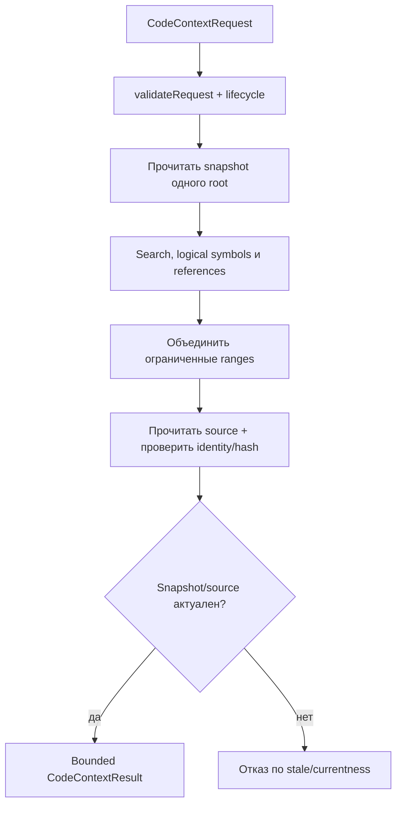
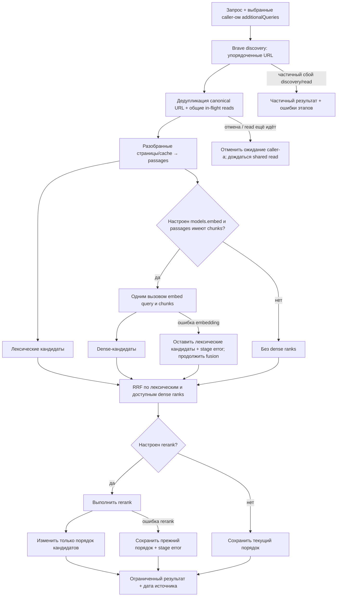
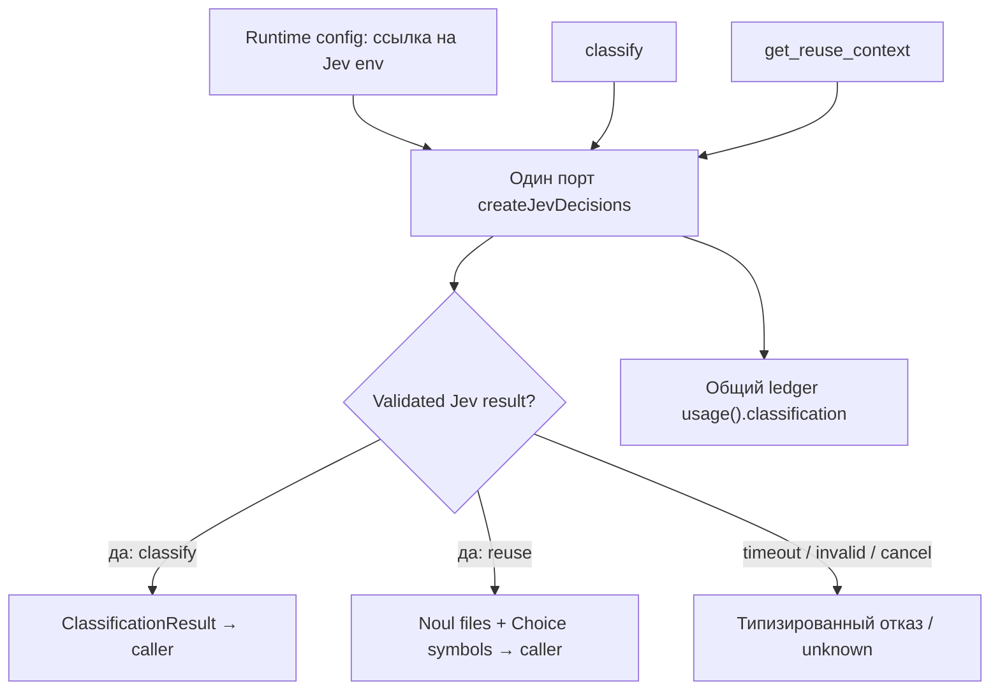
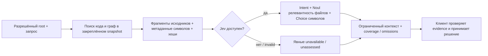

# Context: bounded code и web context

Context валидирует явный запрос и объединяет доступные материалы в ограниченный ответ. Источники, excerpts и classification — недоверенные evidence; вызывающий агент проверяет их и принимает решение.

## Code context — source candidate

## Web context — source candidate

Caller задаёт запросы; web-поиск не придумывает дополнительные темы.

Профиль embedding проверяется при создании контекста. Если заданы `models.embed` и passages с chunks, один вызов получает query и chunks. При ошибке embedding lexical candidates сохраняются, stage error фиксируется и обработка продолжает fusion. При ошибке rerank сохраняются прежний порядок и stage error.

## Classification — shared Jev port

## Переиспользование кода — source candidate `0a584e6`

По умолчанию SDK ограничивает контекст 48 000 символами и 24 файлами-кандидатами; deadline операции — 60 секунд. Путь reuse использует тот же Jev port runtime, что и classification; его вызовы учитываются в общем ledger `usage().classification`. Он не меняет embedding/rerank профили, prompt, модель или workflow клиента. Source candidate и оставшиеся границы приёмки описаны в [руководстве Jev](../../docs/jev-classification.md).

| Условие | Результат | Кодовая опора |
| --- | --- | --- |
| Code snapshot/source hash изменился | Старые ranges не возвращаются как current. | `createCodeContext`, `collectLogicalContext` |
| Jev в reuse недоступен или ответ некорректен | Без локальных семантических эвристик; выбор файлов остаётся `unassessed`/`unknown`. | `createReuseContext`, `reuse-selection.ts` |
| Покрытие чтения символов или исходников неполное | Ограниченные кандидаты сопровождаются явным состоянием, omissions и continuation. | `createReuseContext`, `reuse-types.ts` |
| Web часть упала, но страницы есть | Partial result и errors по этапам. | `createWebSearch` |
| Web embedding/rerank provider error | Ошибка сохраняется в `errors`, `partial=true`; lexical passages могут остаться в ответе, поэтому сбой не скрыт. | `web.ts` |
| Caller отменил shared read | Его ожидание отменяется отдельно; физический fetch не считается завершённым раньше settlement. | `BraveInFlightDocuments` |
| Additional query отсутствует | Search не придумывает его сам. | `snapshotAdditionalQueries` |

Web — публичный HTTP acquisition, не browser automation. Logical symbol/reference связи статические и не являются runtime call truth. Исходники: [`index.ts`](https://github.com/zoomplus/zorya-search/blob/main/src/context/index.ts), [`logical.ts`](https://github.com/zoomplus/zorya-search/blob/main/src/context/logical.ts), [`web.ts`](https://github.com/zoomplus/zorya-search/blob/main/src/context/web.ts), [`classify.ts`](https://github.com/zoomplus/zorya-search/blob/main/src/context/classify.ts), [`lifecycle.ts`](https://github.com/zoomplus/zorya-search/blob/main/src/context/lifecycle.ts).

Jev не расширяет `additionalQueries`, не выбирает embedding/rerank модель и не меняет workflow агента. Проверенные полные или частичные диапазоны, source identity, evidence и omissions передаются клиенту; он решает, что проверить или изменить. GitHub archive `v0.1.6` не содержит этот source candidate.
