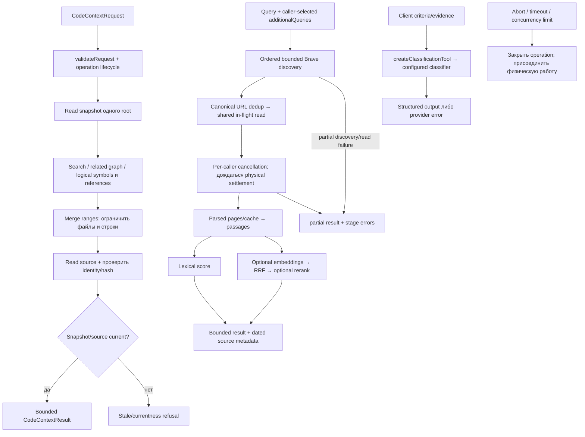

# Context: bounded code и web context

Context валидирует явный запрос и объединяет доступные материалы в ограниченный ответ. Источники, excerpts и classification — недоверенные evidence; вызывающий агент проверяет их и принимает решение.

| Условие | Результат | Кодовая опора |
| --- | --- | --- |
| Code snapshot/source hash изменился | Старые ranges не возвращаются как current. | `createCodeContext`, `collectLogicalContext` |
| Web часть упала, но страницы есть | Partial result и errors по этапам. | `createWebSearch` |
| Web embedding/rerank provider error | Ошибка сохраняется в `errors`, `partial=true`; lexical passages могут остаться в ответе, поэтому сбой не скрыт. | `web.ts` |
| Caller отменил shared read | Его ожидание отменяется отдельно; физический fetch не считается завершённым раньше settlement. | `BraveInFlightDocuments` |
| Additional query отсутствует | Search не придумывает его сам. | `snapshotAdditionalQueries` |

Web — публичный HTTP acquisition, не browser automation. Logical symbol/reference связи статические и не являются runtime call truth. Исходники: [`index.ts`](https://github.com/zoomplus/zorya-search/blob/main/src/context/index.ts), [`logical.ts`](https://github.com/zoomplus/zorya-search/blob/main/src/context/logical.ts), [`web.ts`](https://github.com/zoomplus/zorya-search/blob/main/src/context/web.ts), [`classify.ts`](https://github.com/zoomplus/zorya-search/blob/main/src/context/classify.ts), [`lifecycle.ts`](https://github.com/zoomplus/zorya-search/blob/main/src/context/lifecycle.ts).
