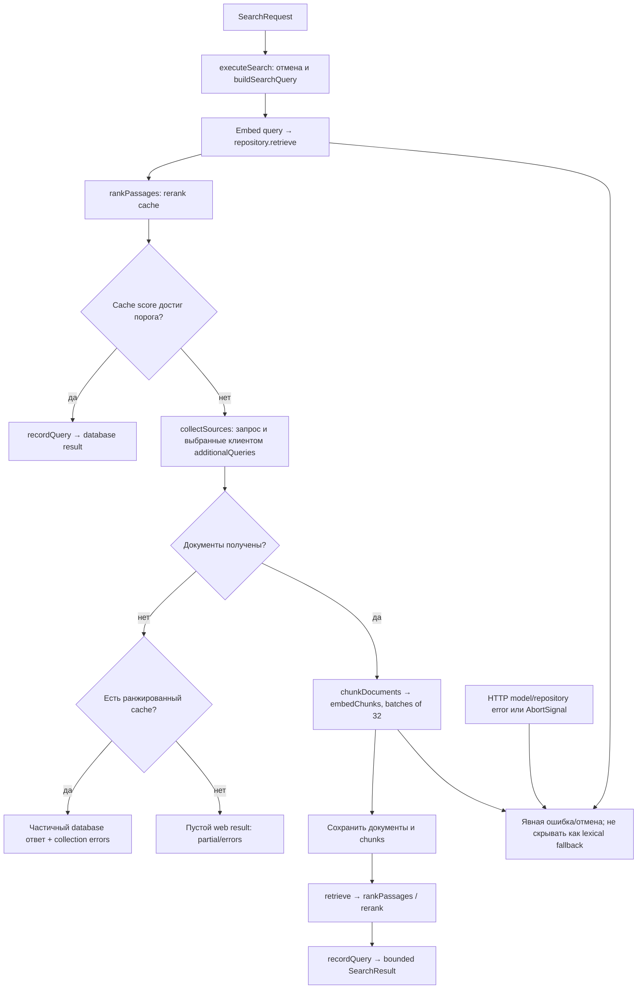

# Core: поиск и извлечение

Core связывает collection, модели embeddings/rerank и knowledge repository. Клиент получает ограниченные passages с происхождением и признаками частичности; итоговое решение остаётся у вызывающей стороны.

| Условие | Результат | Кодовая опора |
| --- | --- | --- |
| Cache score ≥ порога | Возвращаются database passages без нового collection. | `executeSearch`, `evaluateSearchCache` |
| Collection неполная или бюджет истёк | `partial` и этапные `errors` сохраняются; при пустой collection возможен лишь ранжированный cache. | `collectSources`, `cachePartialFallback` |
| HTTP embedding/rerank завершился ошибкой | Ошибка проходит выше; автоматической lexical подмены нет. | `embedChunks`, `rankPassages` |

Файлы: [`search.ts`](https://github.com/zoomplus/zorya-search/blob/main/src/core/search.ts), [`indexing.ts`](https://github.com/zoomplus/zorya-search/blob/main/src/core/indexing.ts), [`retrieval.ts`](https://github.com/zoomplus/zorya-search/blob/main/src/core/retrieval.ts), [`reindex.ts`](https://github.com/zoomplus/zorya-search/blob/main/src/core/reindex.ts). Storage сохраняет данные; providers исполняют настроенные порты. Ничто из результата не применяется к исходникам автоматически.
