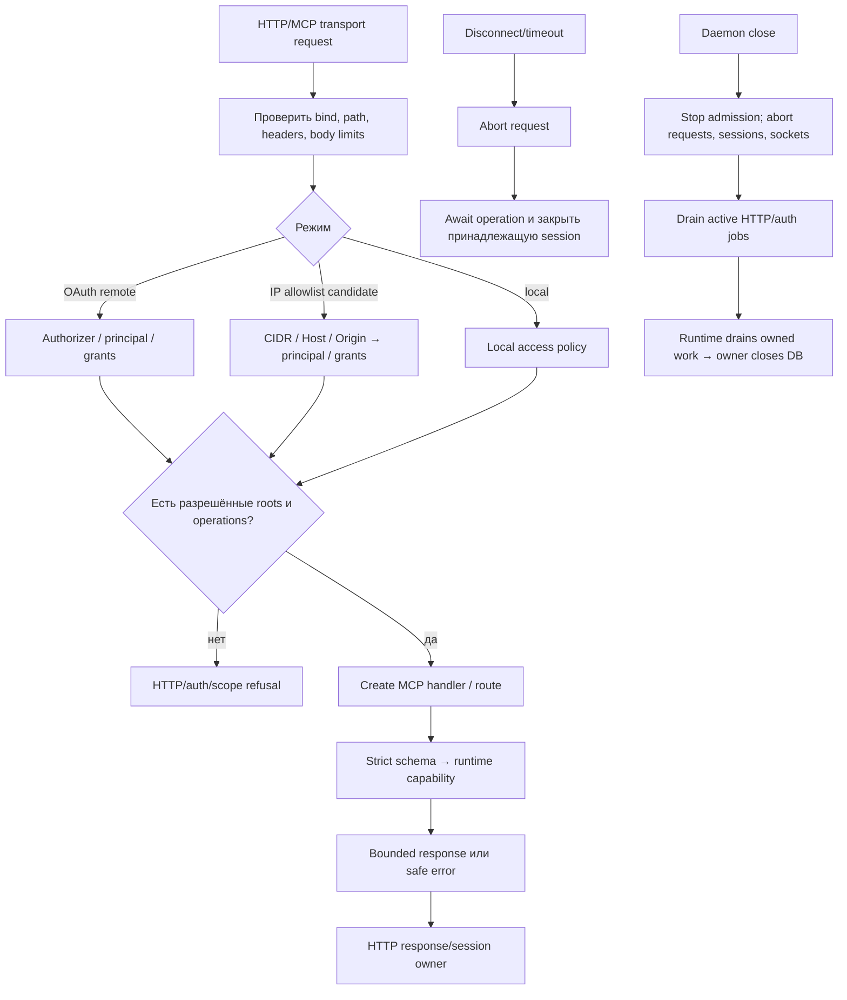

# Daemon: HTTP transport и lifecycle

Daemon принимает HTTP transport, проверяет transport access policy и направляет разрешённые MCP operations к runtime. При disconnect/close он отменяет принадлежащие requests и дожидается их завершения.

| Условие | Результат | Кодовая опора |
| --- | --- | --- |
| Неверные bind/path/header/body | Отказ до dispatch. | `startSearchDaemon` |
| Нет remote principal/grant | Отказ с root/operation scope. | `SearchDaemonAuthorizer`, `snapshotAccess` |
| IP mode: peer/CIDR, Host или Origin не прошли policy; присутствует Authorization | Отказ до dispatch; forwarded `X-Real-IP` учитывается только для доверенного proxy. | `createSearchIpAccessPolicy`, `startSearchDaemon` |
| Client disconnect | Abort конкретного request; дождаться settlement перед освобождением session. | `requestControllers`, `closeSession` |
| Daemon close | Stop admission, drain jobs/connections. | `close` |
| Внешний TLS/issuer | Настраивает deployment owner; код не доказывает deployment acceptance. | transport contract |
| Candidate `v0.1.11` IP mode | Явная policy без bearer/OAuth; metadata `noauth` только в этом режиме, grants остаются серверными. | `serve-remote-ip`, `ip-access.ts` |

Daemon не управляет client agent. Источник: [`index.ts`](https://github.com/zoomplus/zorya-search/blob/main/src/daemon/index.ts).
