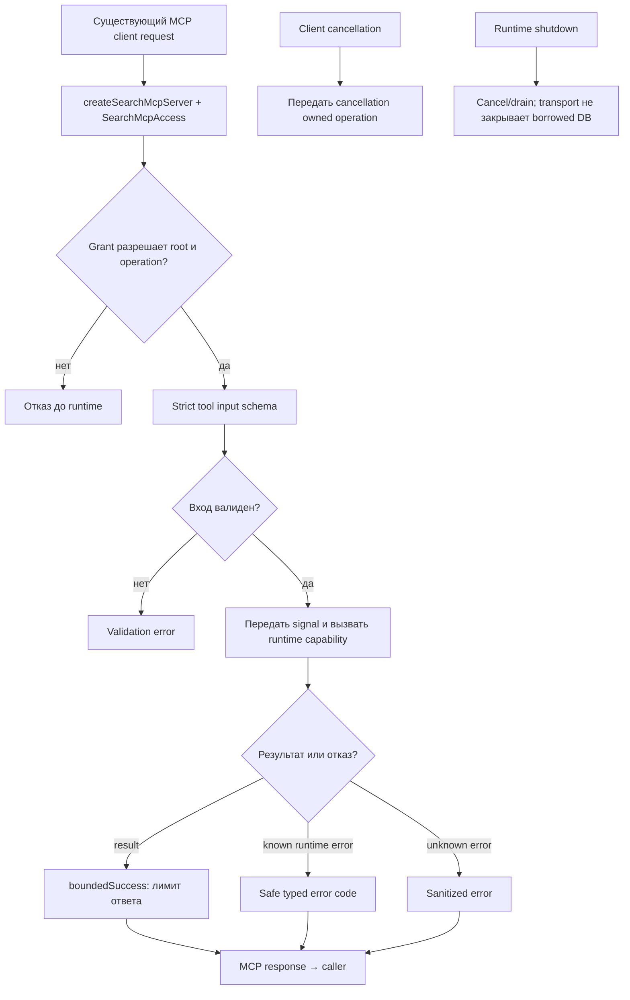

# MCP: tools существующему клиенту

MCP server публикует инструменты для уже подключённого клиента поверх runtime. Он проверяет grants для roots/operations, валидирует inputs, ограничивает размер ответа и сериализует результат или safe error.

| Условие | Результат | Кодовая опора |
| --- | --- | --- |
| Grant не разрешает root/operation | Tool не вызывает runtime. | `createSearchMcpServer` |
| Invalid input | Strict schema error. | `SEARCH_MCP_TOOL_CONTRACTS`, runtime request schemas |
| Oversized response | Успешная выдача полного якобы bounded ответа запрещена. | `boundedSuccess` |
| Известный runtime error | Возвращается стабильный safe code. | `safeCode` |
| Capability disabled | Conditional tool не регистрируется, например project-text/visual. | tool registration |

MCP — transport adapter, не agent/decision engine. Контракты: [`server.ts`](https://github.com/zoomplus/zorya-search/blob/main/src/mcp/server.ts). Remote daemon/OAuth — другой слой.
