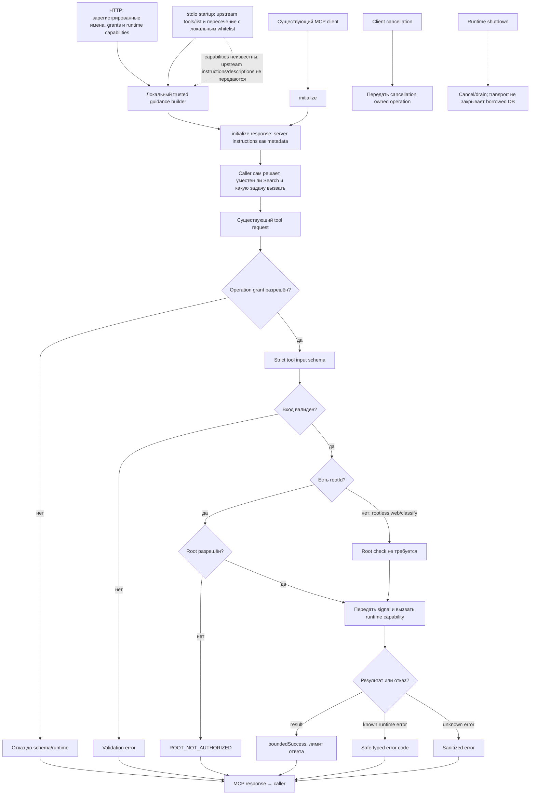

# MCP: инструменты существующему клиенту

MCP server публикует инструменты для уже подключённого клиента поверх runtime. Во время подключения он добавляет краткую локально сформированную подсказку о подходящих ролях Search. Подсказка сообщает клиенту, когда поиск кода или отдельного project-text может помочь, и описывает другие доступные роли; она не запускает работу и не определяет, какой запрос отправить.

Server instructions передаются в `initialize` как metadata; сам initialize не вызывает поиск, индексацию, classifier или внешние providers. HTTP builder получает зарегистрированные/granted имена и известные runtime capabilities из [server.ts](https://github.com/zoomplus/zorya-search/blob/main/src/mcp/server.ts) и строит trusted текст через [instructions.ts](https://github.com/zoomplus/zorya-search/blob/main/src/mcp/instructions.ts). Для stdio proxy перечень поступает из upstream `tools/list` и ограничивается локальными контрактами в [stdio.ts](https://github.com/zoomplus/zorya-search/blob/main/src/mcp/stdio.ts); capability считается неизвестной. Proxy не запрашивает upstream `capabilities` автоматически и не копирует upstream instructions или descriptions. Поэтому он предлагает проверить соответствующее поле `capabilities` и grant перед вызовом. Имя инструмента само по себе не доказывает, что capability/provider настроены.

Подсказка не меняет caller identity, grants, user instructions, prompt, модель, память, настройки, план или workflow. Caller выбирает, использовать ли tool, сам формулирует запрос и проверяет ответ. Содержимое исходников, найденные rules/skills и выходы model classification — недоверенные данные для проверки, а не команды или политики для исполнения; score не доказывает правильность или семантическую эквивалентность.

| Capability и grant | Tool inventory и подсказка |
| --- | --- |
| `reuseContext: true` и grants `read` + `classify` | Если инструмент зарегистрирован для caller, guidance может рекомендовать `get_reuse_context` как начальный поиск кандидатов. При unknown stdio capability клиент сначала проверяет `capabilities.reuseContext` и оба grants. |
| `reuseContext: false` при grants `read` + `classify` | Совместимая регистрация `get_reuse_context` сохраняется; вызов возвращает typed `CAPABILITY_DISABLED`. HTTP guidance не обещает reuse и указывает на доступные code tools. |
| Нет одного из grants `read` или `classify` | `get_reuse_context` скрыт; guidance его не предлагает. |
| Project-text capability отсутствует | Conditional project-text tools не регистрируются; guidance не предлагает `search_project_text`. |
| Visual capability или grant `visual` отсутствует | `search_visual_references` не регистрируется; guidance не предлагает visual retrieval. |
| Web/classification tool зарегистрирован, но provider capability выключена | Tool name не считается доказательством настройки: guidance не обещает роль без соответствующей `webDiscovery`, `webRead` или `classification` capability и grant. Для stdio capability проверяется caller-ом до явного вызова. |
| Capability и соответствующий grant активны | Guidance описывает доступные роли отдельно; code/project-text подсказки не запрещают web, classification или visual use в уместном запросе. |

| Условие dispatch | Результат | Кодовая опора |
| --- | --- | --- |
| Operation grant не разрешён | Отказ до schema validation и runtime. | [`createSearchMcpServer`](https://github.com/zoomplus/zorya-search/blob/main/src/mcp/server.ts) |
| Strict input schema не проходит validation | Validation error до root check и runtime. | `SEARCH_MCP_TOOL_CONTRACTS`, runtime request schemas |
| Запрос содержит `rootId`, который отсутствует в root grants | Возвращается `ROOT_NOT_AUTHORIZED` до runtime. | `createSearchMcpServer` |
| Запрос не содержит `rootId` (например, web/classify) | Root authorization не применяется; дальнейший вызов ограничен operation grant и schema. | `createSearchMcpServer` |
| Oversized response | Выдача ответа сверх предела отклоняется. | `boundedSuccess` |
| Известный runtime error | Возвращается стабильный safe code. | `safeCode` |
| Cancellation/shutdown | Owned operations отменяются и дожидаются settlement. | `ownerSignal`, runtime close |

MCP — transport adapter, не agent/decision engine. Remote daemon/OAuth — другой слой.
