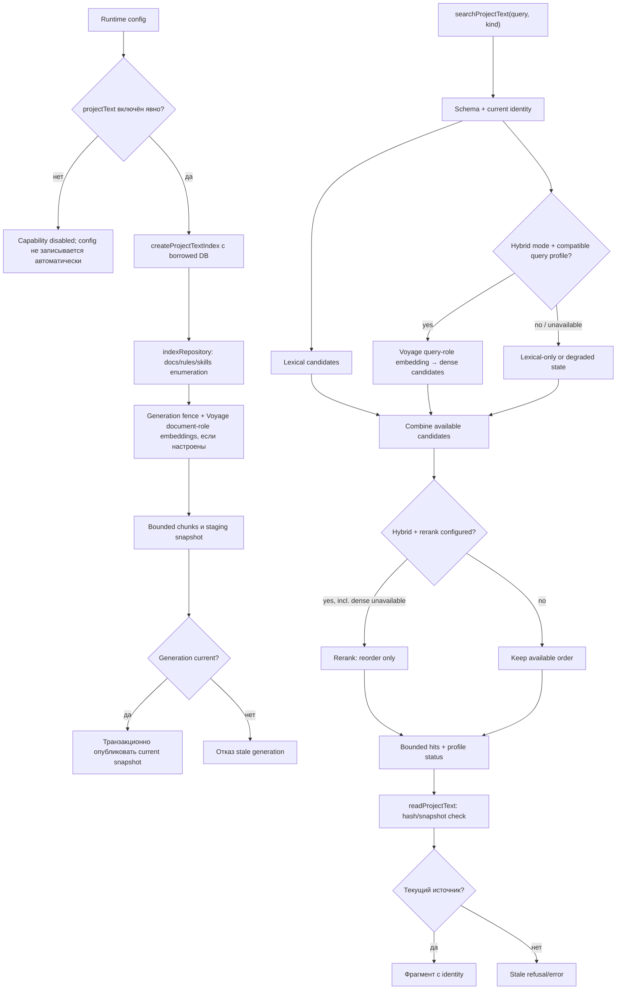

# Project Text: docs, rules и skills

Отдельный namespace `zorya_project_text_*` индексирует документацию, rules и skills, не смешивая их с code index/knowledge storage. Capability существует только при явном `projectText` config; index использует borrowed database.

| Условие | Результат | Кодовая опора |
| --- | --- | --- |
| Нет `projectText` config | Capability не создаётся. | `runtime/config.ts`, `runtime/index.ts` |
| Нет embedding profile | Lexical доступен, dense не заявляется. | `ProjectTextOptions`, `indexStatus` |
| Hybrid при недоступном dense профиле | Rerank всё ещё может упорядочить lexical candidates; эта ветка отличается от code gate. | `searchProjectText`, rerank path |
| Поколение сменилось | Staging snapshot не публикуется. | `indexRepository` |
| HTTP provider failure | Ошибка операции остаётся ошибкой. | embedding/rerank ports |
| Source hash/snapshot устарел | Не выдавать старый текст как current. | `readProjectText` |

Необязательный конфигурационный preset `voyageai/voyage-4-large` (1024d) разделяет `document`-роль при индексации и `query`-роль при поиске; включение требует явного `projectText` config. Необязательный `voyageai/rerank-2.5-lite` только меняет порядок уже найденных кандидатов и не доказывает их корректность. Сам модуль не выводит query intent. Исходники: [`index.ts`](https://github.com/zoomplus/zorya-search/blob/main/src/project-text/index.ts), [`types.ts`](https://github.com/zoomplus/zorya-search/blob/main/src/project-text/types.ts), [`schema.ts`](https://github.com/zoomplus/zorya-search/blob/main/src/project-text/schema.ts). Эти исходники сами по себе не означают включение capability в публичный archive `v0.1.6`.
