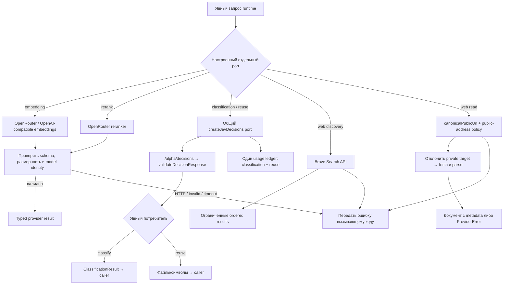
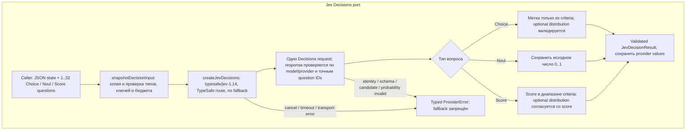
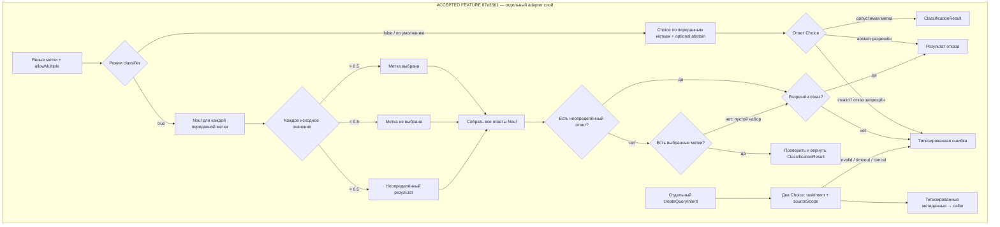

# Providers: модели, web и решения Jev

Provider получает явные данные и конфигурацию от вызывающего слоя. Он возвращает ограниченный типизированный ответ или ошибку; provider не выбирает, что клиент должен искать или менять. В preview `v0.1.7` (source `3be35fd`) runtime создаёт один pinned Jev Decisions port, который разделяют classification и reuse. Embedding и rerank остаются отдельными retrieval-портами.

## Provider-потоки source candidate

| Операция | Что проверяется и кто принимает следующее решение | Исходники |
| --- | --- | --- |
| Embedding | Provider проверяет ответ и размерность; вызывающий retrieval строит dense candidates. Ошибка HTTP остаётся ошибкой, не скрытым lexical результатом. | `openrouter.ts`, `runtime/index.ts` |
| Rerank | Provider возвращает индексы/оценки кандидатов; вызывающий слой проверяет индексы и использует порядок. Оценка не доказывает истинность источника. | `openrouter.ts`, consumers in `core`, `code`, `context` |
| Classification и reuse | Оба потребителя используют общий pinned `typesafe/jev-1.14` Decisions port. Вердикт строится Jev; `usage().classification` учитывает их общие вызовы. | `decisions.ts`, `jev-classifier.ts`, `context/reuse.ts`, `runtime/index.ts` |
| Brave discovery/read | Проверяется публичность URL и ограничения загрузки; discovery/read failure остаётся provider error или этапной partial ошибкой в context. | `brave.ts`, `brave-inflight.ts`, `context/web.ts` |

## Jev Decisions и semantic adapters

`createJevDecisions` использует `typesafe/jev-1.14`, маршрут TypeSafe без fallback, endpoint `/api/alpha/decisions` и одну попытку транспорта. Ответы и cancellation/timeout проверяются до передачи adapter-у. Полная migration/API-сводка дана в [руководстве Jev](../../docs/jev-classification.md).

| Режим | Что задаёт вопрос и что проверяется в ответе | Следующий потребитель |
| --- | --- | --- |
| `Choice` | Caller задаёт точные варианты и criteria. Выбранная метка должна входить в них. Если distribution отсутствует, сохраняется `provider-choice`; если задана — нужны ровно её ячейки, конечные значения `0..1`, допустимая unit mass и выбранный вариант как единственный native максимум. Raw вероятности не нормализуются. | `createJevClassifier` или `createQueryIntent` превращает ответ в свой typed result. |
| `Noul` | Бинарный вопрос с caller criteria `{true,false}`; provider возвращает исходное `noul` от `0` до `1`. Сам `createJevDecisions` не назначает порог и не превращает его в intent. | Только adapter, который явно задаёт интерпретацию, например multi-label classifier ниже. |
| `Score` | Caller задаёт от 2 до 10 уровней. `score` ограничен диапазоном `0..criteria.length-1`; optional distribution должна иметь точные ячейки и быть согласована с допустимым ожидаемым score. | Непосредственный consumer решения. `createJevClassifier` Score не вызывает. |

Для распределений с точной единичной суммой сохраняются исходные значения. Допускается также 0.01 lattice, если интервалы округления совместимы с единичной массой; метаданные округления объясняют провайдерную сетку и не переписывают значения. При наличии probabilities в `Choice` tied maxima — ошибка. Ответ обязан содержать ровно все запрошенные question IDs; model identity должна быть Jev 1.14 alias/valid dated revision, provider — `TypeSafe`. Cancellation, timeout, transport failure и malformed/unsupported answer становятся typed provider errors; semantic fallback на keyword/regex отсутствует.

## Adapter-развилки того же feature commit

| Adapter | Формирование вопросов | Ветвь результата |
| --- | --- | --- |
| `createJevClassifier`, `allowMultiple=false` (default) | Один `Choice` по переданным меткам; при разрешённом abstain добавляется явный вариант отказа. Для 200 меток с abstain Choice не вмещает дополнительный вариант: перед ним выполняется отдельный Noul-вопрос о наличии подходящей метки. `Score` не подключён. | Валидная метка → `ClassificationResult`; отказ → abstain либо typed error; затем локальная проверка результата. |
| `createJevClassifier`, `allowMultiple=true` | Noul для каждой supplied label, партиями максимум по 32 за запрос. | `noul > 0.5` выбирает метку, `< 0.5` исключает, `= 0.5` unresolved. Любой unresolved даёт abstain/error; без unresolved возвращается набор выбранных меток, а пустой набор — abstain/error. |
| `createQueryIntent` | Буквальный запрос передаётся как data в `query_text`; два `Choice`: `taskIntent` и `sourceScope`. Человеческие критерии задают варианты; запрос не исполняется как инструкция. | Только типизированные метаданные к caller-у. Само по себе не фильтрует и не запускает web/code search, не меняет файлы и не выбирает модель caller-а. |

`taskIntent`: `locate_symbol`, `implement_change`, `explain_behavior`, `find_duplicates`, `find_documentation`, `find_tests`, `mixed`, `unknown`. `sourceScope`: `implementation`, `documentation`, `tests`, `mixed`, `unspecified`. `unknown` и `unspecified` — допустимые значения. `implement_change` описывает просьбу пользователя, но не решает, нужен ли новый код; перед реализацией caller проверяет существующий код, extension points, дубликаты и контракты. Запрос о выполнимости одного поведения остаётся `explain_behavior`; `mixed` требует разных явно запрошенных результатов.

Исходники provider-потоков зафиксированы на source candidate `0a584e64c10d1a9d46b18d1e199979f2787f647d`: [`decision-types.ts`](https://github.com/zoomplus/zorya-search/blob/0a584e64c10d1a9d46b18d1e199979f2787f647d/src/providers/decision-types.ts), [`decisions.ts`](https://github.com/zoomplus/zorya-search/blob/0a584e64c10d1a9d46b18d1e199979f2787f647d/src/providers/decisions.ts), [`decision-validation.ts`](https://github.com/zoomplus/zorya-search/blob/0a584e64c10d1a9d46b18d1e199979f2787f647d/src/providers/decision-validation.ts), [`jev-classifier.ts`](https://github.com/zoomplus/zorya-search/blob/0a584e64c10d1a9d46b18d1e199979f2787f647d/src/providers/jev-classifier.ts), [`query-intent.ts`](https://github.com/zoomplus/zorya-search/blob/0a584e64c10d1a9d46b18d1e199979f2787f647d/src/providers/query-intent.ts), [`classifier.ts`](https://github.com/zoomplus/zorya-search/blob/0a584e64c10d1a9d46b18d1e199979f2787f647d/src/providers/classifier.ts), [`openrouter.ts`](https://github.com/zoomplus/zorya-search/blob/0a584e64c10d1a9d46b18d1e199979f2787f647d/src/providers/openrouter.ts), [`brave.ts`](https://github.com/zoomplus/zorya-search/blob/0a584e64c10d1a9d46b18d1e199979f2787f647d/src/providers/brave.ts), [`brave-inflight.ts`](https://github.com/zoomplus/zorya-search/blob/0a584e64c10d1a9d46b18d1e199979f2787f647d/src/providers/brave-inflight.ts), [`voyage.ts`](https://github.com/zoomplus/zorya-search/blob/0a584e64c10d1a9d46b18d1e199979f2787f647d/src/providers/voyage.ts). Прежний provider foundation принят отдельным коммитом `67e3361`; эти ссылки фиксируют интегрированный candidate с адаптером runtime.
