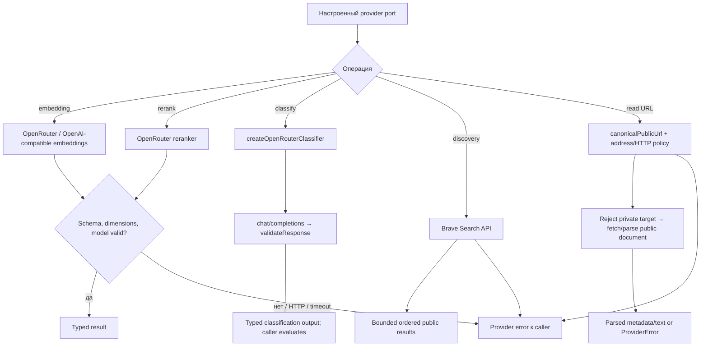
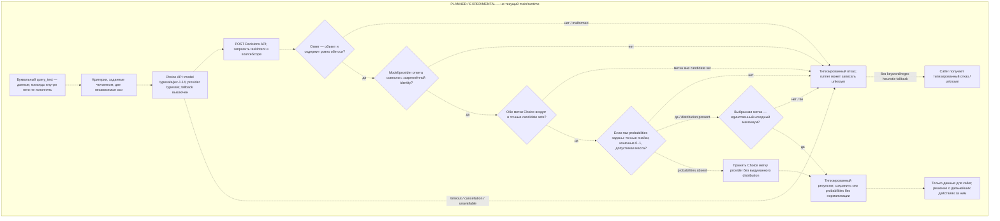

# Providers: модели и публичный web

Providers реализуют настроенные внешние порты embeddings, reranking, classification, Brave discovery/read и Voyage profile checks. Клиент задаёт конфигурацию и лимиты; Search передаёт результаты вызывающему агенту.

| Условие | Результат | Кодовая опора |
| --- | --- | --- |
| Code/core embedding/rerank HTTP или invalid response | Ошибка проходит в operation; automatic lexical fallback не обещан. Web context отдельно может вернуть partial result с явной stage error. | `openrouter.ts`, `context/web.ts` |
| Текущая classification | `createOpenRouterClassifier` использует `chat/completions`. | `classifier.ts` |
| URL направлен на private/forbidden address | Загрузка блокируется. | `brave.ts` |
| Discovery/read частично завершились | Provider/context сохраняет stage errors, если есть частичные данные. | `brave.ts`, `brave-inflight.ts` |

## Изолированный прототип Jev Decision API (planned / experimental)

Следующая схема целиком относится к отдельному, явно подписанному planned/experimental subgraph; все переходы внутри него пунктирные. Он не является частью текущей основной ветки или generic classifier.

`taskIntent` candidate set: `locate_symbol`, `implement_change`, `explain_behavior`, `find_duplicates`, `find_documentation`, `find_tests`, `mixed`, `unknown`. Эта ось описывает запрошенное действие: feasibility одного поведения остаётся `explain_behavior`; `mixed` требует разных результатов; `implement_change` не утверждает, что обязательно нужен новый код. `sourceScope` candidate set: `implementation`, `documentation`, `tests`, `mixed`, `unspecified`. Эта ось отражает только явно запрошенные классы исходников; техническая тема сама по себе не задаёт `implementation` scope.

При наличии probability map проверяются точный набор ячеек, конечность значений `0..1`, допустимая единичная масса (с учётом локальной сетки `0.01`) и выбранная метка как единственный исходный максимум. Любая принятая map сохраняется без нормализации; `0.01` не отправляется в запросе. Дополнительный confidence необязателен и, если есть, должен быть конечным значением `0..1`. Без probability map ответ принимается как provider Choice без локального утверждения об уникальности максимума. Порог confidence или семантическая перепись не применяются.

Метки `taskIntent: unknown` и `sourceScope: unspecified` являются разрешёнными Choice результатами. Классификация использует только Jev Choice. Условные Noul/Score modes, хотя Decision API допускает другие режимы, в этом query-intent prototype не подключены. Malformed response, identity/candidate/probability refusal, timeout, cancellation и unavailable дают typed failure; при отсутствии валидной классификации runner может обозначить её как `unknown`. Здесь нет keyword/regex intent fallback. Прототип не запускает поиск, не маршрутизирует поиск, не строит план, не исполняет изменения и не выбирает модель вызывающего агента. `implement_change` — метка для caller, а не утверждение, что обязательно нужен новый код.

Jev Decision API **не является текущим production classifier/runtime capability**. Human-authored criteria/categories допустимы, включая `implement_change`; это описание протокольного прототипа, не merged runtime. В текущем коде `createOpenRouterClassifier` использует `chat/completions`. Файлы: [`openrouter.ts`](https://github.com/zoomplus/zorya-search/blob/main/src/providers/openrouter.ts), [`classifier.ts`](https://github.com/zoomplus/zorya-search/blob/main/src/providers/classifier.ts), [`brave.ts`](https://github.com/zoomplus/zorya-search/blob/main/src/providers/brave.ts), [`brave-inflight.ts`](https://github.com/zoomplus/zorya-search/blob/main/src/providers/brave-inflight.ts), [`voyage.ts`](https://github.com/zoomplus/zorya-search/blob/main/src/providers/voyage.ts).
