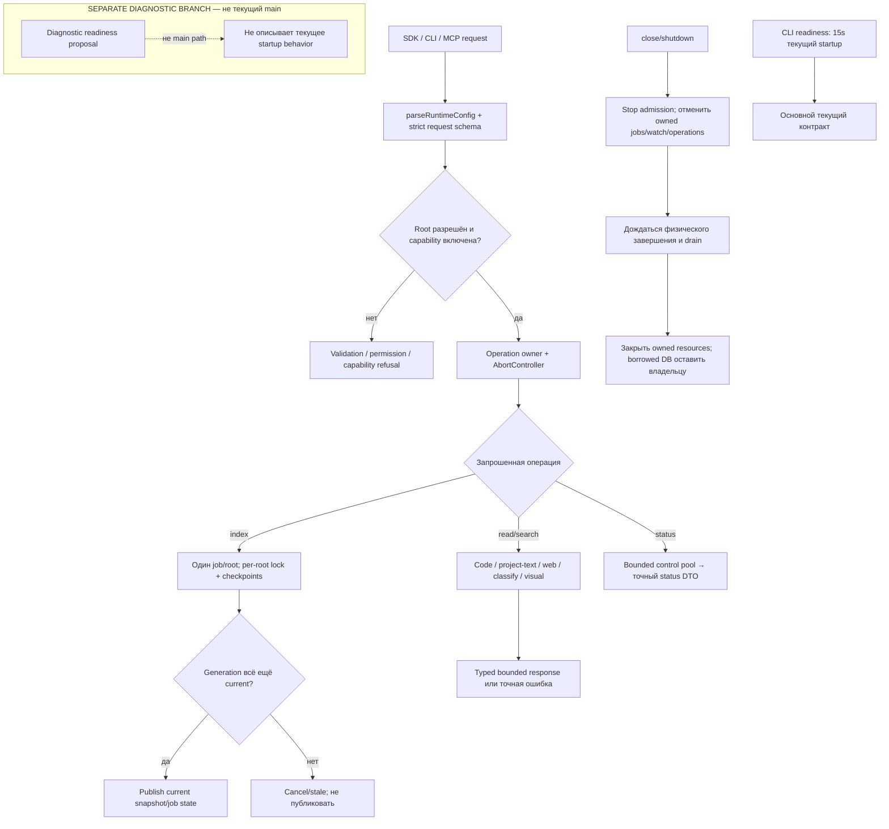

# Runtime: конфигурация и владение операциями

Runtime валидирует config/request, выбирает включённые capabilities и владеет root, jobs, watchers и активными operations. SDK/CLI/MCP вызывают runtime; библиотека не управляет агентами клиента.

| Условие | Результат | Кодовая опора |
| --- | --- | --- |
| Неизвестный root или strict schema invalid | Отказ до dispatch. | `requests.ts`, `openSearchRuntime` |
| `projectText` отсутствует | Capability отключена, config не меняется автоматически. | `config.ts`, `capabilities()` |
| Повторный index того же root | Переиспользование активного job; cancel требует точные `rootId`/`jobId`. | `startIndexing`, `cancelIndexing` |
| Generation устарел | Не публиковать старое состояние. | `indexRepository` |
| Shutdown | Сначала cancel и физический drain, затем owned DB close. | runtime close path |
| CLI startup readiness | Сейчас 15 секунд; отдельная diagnostic ветка не основной путь. | CLI startup caller |

Schemas: `runtime/requests.ts`; capabilities, provider profiles и secret references: `runtime/config.ts`. См. [`index.ts`](https://github.com/zoomplus/zorya-search/blob/main/src/runtime/index.ts), [`config.ts`](https://github.com/zoomplus/zorya-search/blob/main/src/runtime/config.ts), [`requests.ts`](https://github.com/zoomplus/zorya-search/blob/main/src/runtime/requests.ts).
