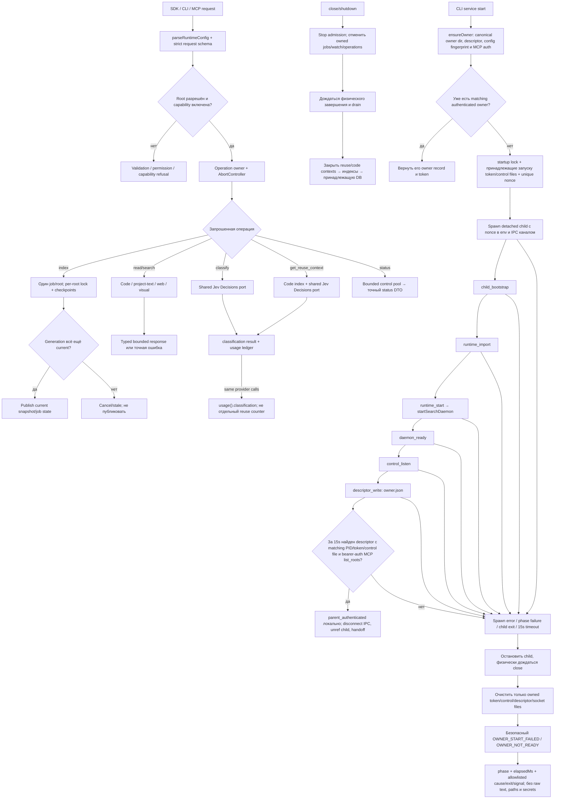

# Runtime: конфигурация и владение операциями

Runtime валидирует config/request, выбирает включённые capabilities и владеет root, jobs, watchers и активными operations. SDK/CLI/MCP вызывают runtime; библиотека не управляет агентами клиента.

В candidate `v0.1.7` (source `3be35fd`) runtime при включённом Jev создаёт один Decisions port для classification и reuse. Этот candidate не входит в GitHub archive `v0.1.6`; npm package ещё не опубликован. Подробности — в [руководстве Jev](../../docs/jev-classification.md).

| Условие | Результат | Кодовая опора |
| --- | --- | --- |
| Неизвестный root или strict schema invalid | Отказ до dispatch. | `requests.ts`, `openSearchRuntime` |
| `projectText` отсутствует | Capability отключена, config не меняется автоматически. | `config.ts`, `capabilities()` |
| `get_reuse_context` без обоих grants | MCP скрывает tool и возвращает `reuseContext: false`; handler проверяет capability до чтения/provider. | `mcp/server.ts` |
| Jev classification или reuse | Оба используют один port; usage и provider profile не дублируются. | `runtime/index.ts`, `decisions.ts` |
| Повторный index того же root | Переиспользование активного job; cancel требует точные `rootId`/`jobId`. | `startIndexing`, `cancelIndexing` |
| Generation устарел | Не публиковать старое состояние. | `indexRepository` |
| Shutdown | Сначала cancel и физический drain, затем owned DB close. | runtime close path |
| CLI startup | `ensureOwner` аутентифицирует matching owner или ждёт nonce-связанный child startup до 15 секунд; только matching PID/credentials/control descriptor и bearer-auth MCP readiness дают handoff. | `ensureOwner`, `StartupDiagnostics` |
| CLI startup timeout/failure | Родитель останавливает и присоединяет физический child, удаляет только принадлежащие операции файлы и выдаёт safe prefix/phase/elapsed/cause metadata. Причина исходного intermittent `OWNER_NOT_READY` остаётся неизвестной. | `service.ts`, `startup-status.ts` |

Schemas: `runtime/requests.ts`; capabilities, provider profiles и secret references: `runtime/config.ts`. См. [`index.ts`](https://github.com/zoomplus/zorya-search/blob/main/src/runtime/index.ts), [`config.ts`](https://github.com/zoomplus/zorya-search/blob/main/src/runtime/config.ts), [`requests.ts`](https://github.com/zoomplus/zorya-search/blob/main/src/runtime/requests.ts), [`service.ts`](https://github.com/zoomplus/zorya-search/blob/main/src/cli/service.ts) и [`startup-status.ts`](https://github.com/zoomplus/zorya-search/blob/main/src/cli/startup-status.ts).

Диагностические фазы уточняют место отказа, но не означают, что причина intermittent `OWNER_NOT_READY` найдена или устранена. Readiness deadline остаётся 15 секунд; до bearer-auth проверки matching endpoint родитель не передаёт управление daemon. Ошибки показывают только префикс, фазу, время и allowlisted cause/exit/signal — не сырое исключение, пути или секреты.
