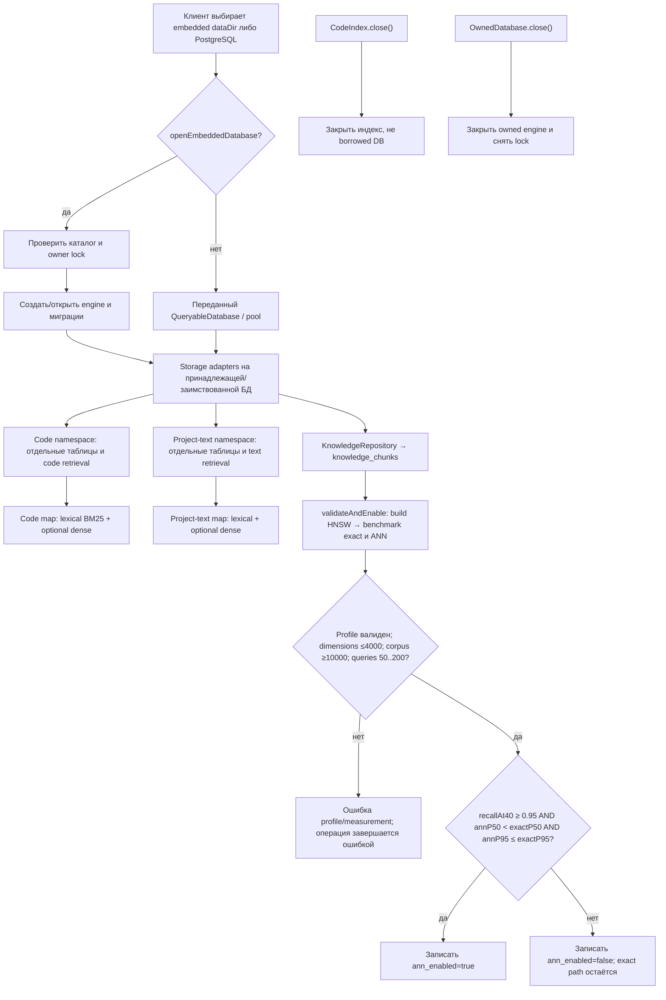

# Storage: базы и repository

`openEmbeddedDatabase` владеет созданным engine и exclusive lock каталога. `createCodeIndex` и project-text index получают заимствованный `QueryableDatabase`; закрытие этих индексов не закрывает БД. Все три семейства используют ресурс базы владельца, но сохраняют свои таблицы, namespaces и retrieval paths.

| Условие | Результат | Кодовая опора |
| --- | --- | --- |
| Каталог занят другим embedded owner | Открытие отклоняется, lock не перехватывается. | `openEmbeddedDatabase` |
| Закрывается `CodeIndex` или project-text index | Закрывается индекс и его работа; borrowed database остаётся владельцу. | `createCodeIndex`, `createProjectTextIndex`, `close` |
| Профиль или benchmark input не проходит schema/measurement gates | Ошибка вместо статуса, будто ANN прошёл квалификацию. Нужны dimensions ≤4000, corpus ≥10000 и 50–200 query vectors. | `SearchAnnIndex.build`, `SearchAnnIndex.benchmark` |
| Все пороги проходят | Сохранить `ann_enabled=true` для соответствующего knowledge profile. | `SearchAnnIndex.validateAndEnable` |
| Измерения валидны, но хотя бы один порог не пройден | Сохранить `ann_enabled=false`; использовать exact retrieval. | `SearchAnnIndex.validateAndEnable`, `PostgresKnowledgeRepository` |
| SQL/migration/connection failure | Ошибка передаётся выше. | `PostgresKnowledgeRepository`, migrations |

`SearchAnnIndex` квалифицирует ANN только на `knowledge_chunks`; code и project-text используют свои namespaces и retrieval пути. Принимается только измерение, где одновременно `recallAt40 ≥ 0.95`, `annP50 < exactP50` и `annP95 ≤ exactP95`. Это переключатель способа получения knowledge candidates, не оценка истинности или качества найденного текста.

При shutdown сначала отменяется и присоединяется принадлежащая работа, затем владелец закрывает свой ресурс. См. [`embedded.ts`](https://github.com/zoomplus/zorya-search/blob/main/src/storage/embedded.ts), [`repository.ts`](https://github.com/zoomplus/zorya-search/blob/main/src/storage/postgres-repository/repository.ts), [`ann-index.ts`](https://github.com/zoomplus/zorya-search/blob/main/src/storage/ann-index.ts).
