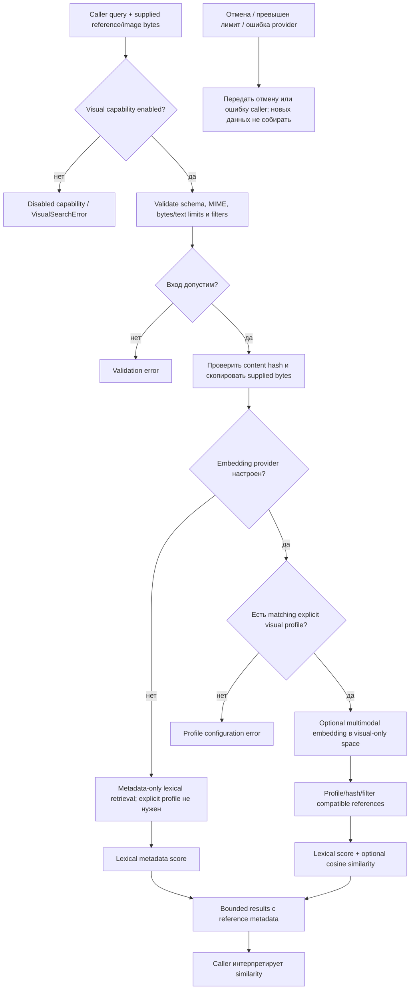

# Visual: отдельный opt-in retrieval

Visual включается отдельно и получает только явно переданные caller text/image references. При `enabled: true` он может работать metadata-only без embeddings; если embedding provider настроен, для него требуется совпадающий явный visual profile. Search не захватывает рабочий стол, не собирает кадры и не выносит judgement о корректности UI.

| Условие | Результат | Кодовая опора |
| --- | --- | --- |
| Visual disabled | Capability отклоняет поиск. При `enabled: true` без embedding provider доступен metadata-only lexical режим. | `createVisualSearch` |
| Embedding provider настроен без matching explicit profile | Конфигурация отклоняется. | `createVisualSearch` |
| Неверный MIME/hash или превышен лимит | Input отклоняется. | `snapshotImage`, `verifyContentHash` |
| Profile несовместим | Не участвует в dense сравнении. | `profileId`, search path |
| Provider error | Ошибка, не уверенность о содержимом. | embedding port |

Visual space отделён от code/project-text. Источник: [`index.ts`](https://github.com/zoomplus/zorya-search/blob/main/src/visual/index.ts).
